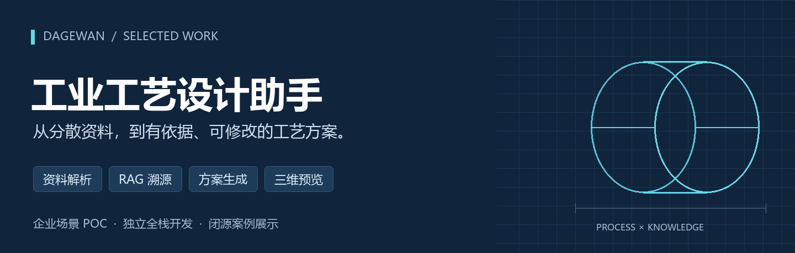
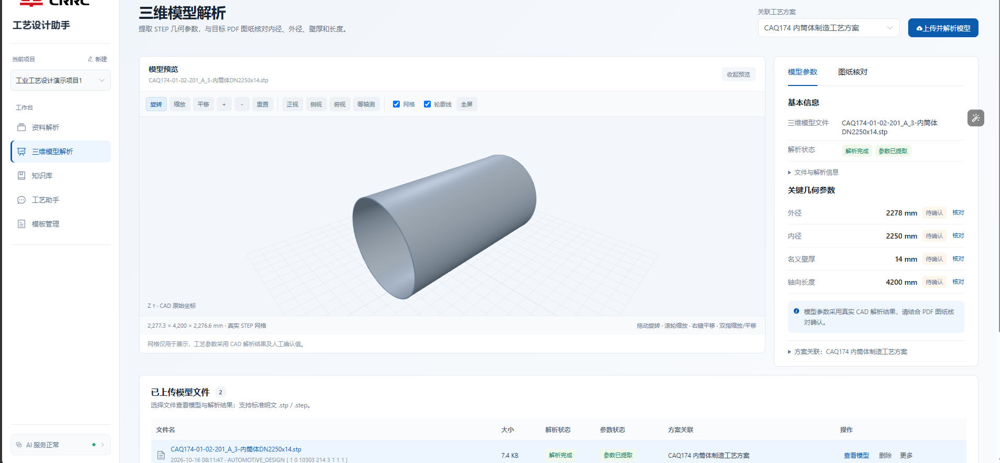
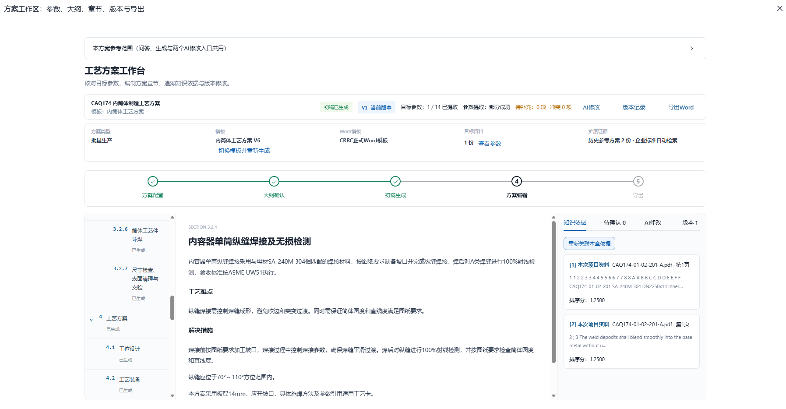
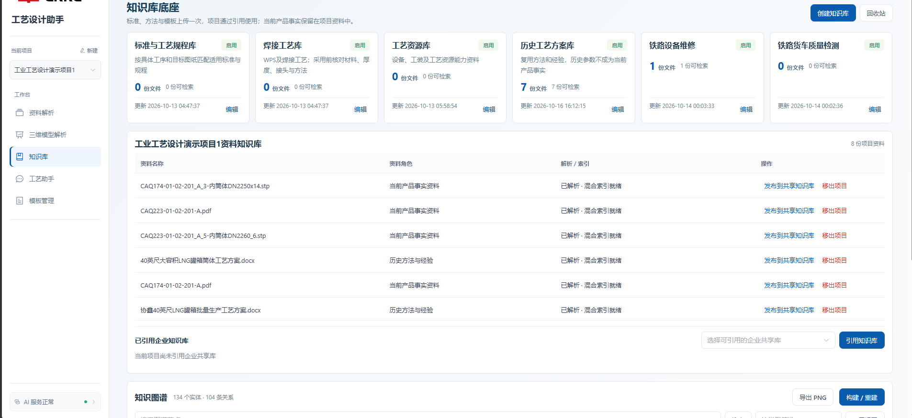
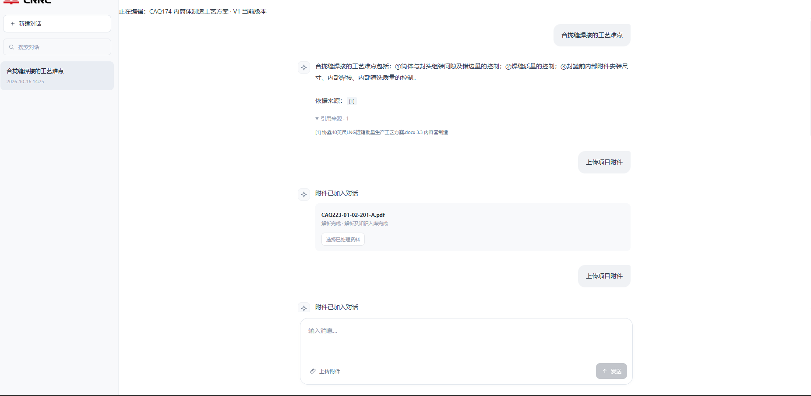
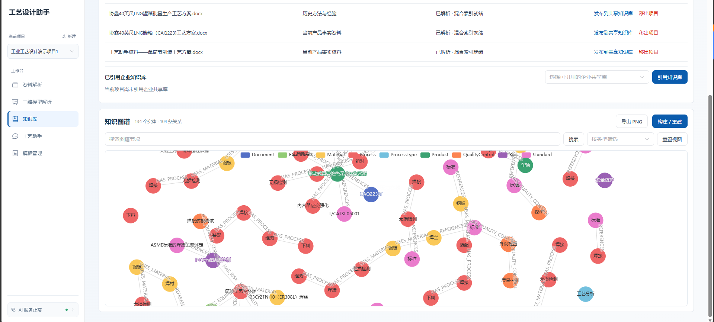
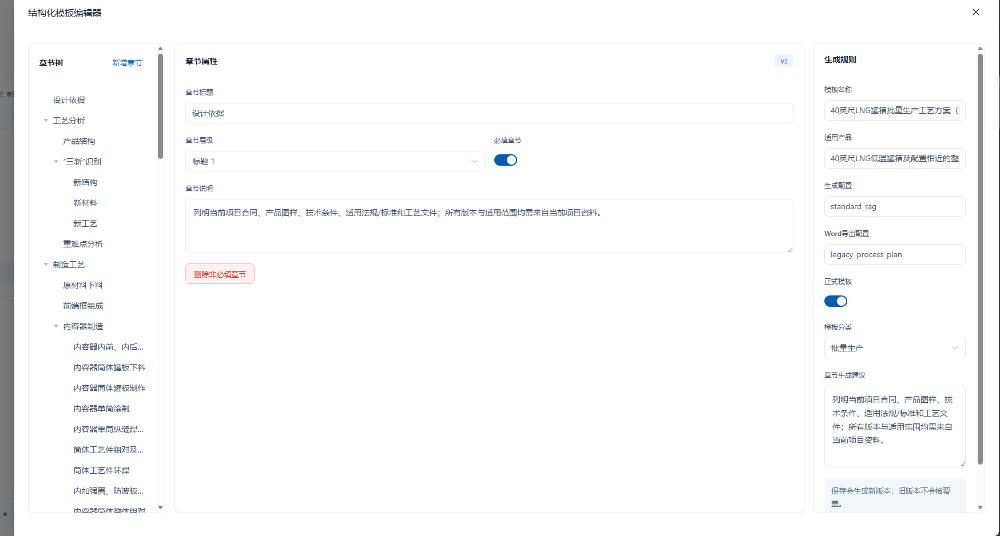
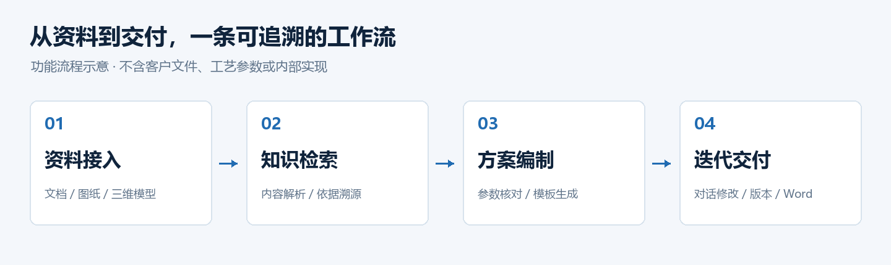

# 工业工艺设计助手

**Industrial Process Design Assistant · 企业场景 POC · 独立全栈开发**

将分散的技术资料、图纸与历史经验，组织为可检索的知识，并辅助完成有依据、可修改、可导出的工艺方案。

本项目围绕工业工艺方案编制流程开发。我独立完成前后端实现，覆盖资料解析、知识检索、AI 方案编制、三维模型预览与文档交付。当前展示范围为 POC 演示能力。

> 本仓库仅展示项目介绍与界面截图，不提供项目源代码、部署包或原始业务文件。商业项目保持闭源。

**[产品界面](#产品界面) · [功能概览](#功能概览) · [开发职责](#我的开发职责) · [工程思考](#关键问题与处理思路) · [项目咨询](https://github.com/DAGEWAN/hhh/issues/new?title=项目合作咨询)**

## 产品界面

以下均为实际 POC 运行界面截图，保留提供时的界面状态。点击图片可查看原始尺寸。

### 三维模型解析与在线预览

在浏览器内查看 STEP 模型，并结合参数面板与方案关联理解当前模型。截图展示旋转、缩放、视角切换和参数核对入口。

### 工艺方案工作台

将章节目录、方案正文、引用依据、AI 修改、版本记录与 Word 导出集中到同一工作区，展示方案编制与交付的核心流程。

### 知识与编制能力

| 企业知识库与资料管理 | 知识问答与依据溯源 |
| --- | --- |
|  |  |
| 区分企业共享知识与当前项目资料，查看资料角色及解析、索引状态。 | 在回答旁展示引用来源，并将项目附件加入当前对话。 |

| 知识图谱与关系浏览 | 结构化模板编辑 |
| --- | --- |
|  |  |
| 以节点和关系浏览资料关联，提供搜索、类型筛选和视图重置入口。 | 通过章节树维护结构、章节属性与规则，支持模板版本迭代。 |

## 解决的业务问题

工艺方案编制需要查阅多种格式的资料、比对当前图纸与历史经验，并按规定结构形成文档。资料分散、依据核对和反复修改，使整个过程难以连续完成。

本项目将这些步骤组织到统一工作台：先处理资料与依据，再辅助生成方案，最后通过人工核对、对话修改和版本管理形成交付文档。

## 功能概览

| 模块 | 已实现的展示能力 |
| --- | --- |
| 多格式资料解析 | PDF、Word、表格、图片 OCR；保留解析状态、失败原因和重试入口 |
| 知识库与检索问答 | 内容切片、关键词与向量混合检索；查看引用文件、页码、章节及相关原文 |
| 知识图谱与模板维护 | 图谱节点与关系浏览、搜索及筛选；通过章节树维护模板结构、章节属性和版本 |
| 工艺方案编制 | 选择资料与模板，核对关键参数，生成大纲并逐章生成方案 |
| 对话修改与版本管理 | 根据自然语言要求修改章节，记录版本，支持查看历史与恢复 |
| Word 文档导出 | 将已保存的方案内容、表格、引用和已确认配图组织为 Word 文档 |
| 三维模型预览 | STEP 模型解析与浏览器三维预览，提供视角切换、旋转、缩放及全屏查看 |

**能力边界：** OCR、旧版 Office 及 DWG 处理依赖相应运行环境；解析失败会显示实际状态。三维预览用于辅助理解模型，不能替代工程尺寸核对。

## 我的开发职责

**本人独立完成项目的前后端开发。**

- **前端工作台**：资料管理、知识检索与引用查看、方案编制与修改、任务状态及三维预览等交互。
- **后端业务**：文件处理、知识索引、检索问答、方案生成与修改、版本保存及文档导出。
- **AI 能力接入**：接入兼容接口的大模型与向量服务，将检索依据、业务约束和人工确认衔接到流程中。
- **流程迭代**：围绕实际演示与业务反馈，持续调整资料、参数、方案内容和交付文档之间的衔接。

## 关键问题与处理思路

### 1. 历史经验不能直接当作当前产品事实

将当前资料、企业规则和历史案例区分使用；关键参数保留来源，缺失和冲突进入待核对流程，避免把参考内容直接当作已确认事实。

### 2. AI 修改需要落到可追踪的文档版本

把章节修改与版本保存衔接起来，让预览和导出围绕已保存版本工作；保留历史内容与引用，便于核对变更。

### 3. 长流程需要清晰的状态与失败反馈

为解析、生成和模型预览呈现处理状态与失败原因，并提供对应重试入口，使演示与问题定位更清楚。

### 4. 三维展示与工程参数各有用途

通过浏览器预览帮助理解模型外形；工艺参数以解析依据及人工确认结果为准，避免把展示网格当作精确测量依据。

## 技术栈

| 层次 | 主要技术 |
| --- | --- |
| 前端应用 | Vue 3、TypeScript、Vite、Element Plus |
| 后端服务 | Python、FastAPI、SQLite |
| 知识检索 | Chroma、SQLite FTS5、关键词与向量混合检索 |
| 文档处理 | PyMuPDF、python-docx、PaddleOCR、openpyxl |
| 三维能力 | Three.js、CadQuery、GLB / glTF |
| 模型接入 | OpenAI 兼容 API 接口 |

## 演示路线

使用合成样例或经授权处理的素材，可以按以下顺序讲解项目：

1. 展示资料接入与解析状态。
2. 提问并打开回答对应的引用依据。
3. 选择模板、核对参数并生成方案。
4. 通过自然语言修改章节，查看保存版本。
5. 查看三维模型预览并导出 Word。

本仓库包含原创封面、功能流程示意图和六张实际界面截图。截图用于展示 POC 的产品形态与操作入口，不等同于在线可操作的演示系统；进一步演示可在沟通中安排。

## 项目状态

这是用于企业场景验证与演示的 POC。已具备上述主要功能链路；本案例不作生产部署、高并发、规模化使用或量化业务收益的承诺，工程输出仍需专业人员核对。

## 求职与项目合作

本案例可用于了解我在 **AI 应用开发、企业知识库、业务工作流和全栈交付** 方面的实践。

[发起项目咨询 →](https://github.com/DAGEWAN/hhh/issues/new?title=项目合作咨询) · [返回个人主页](https://github.com/DAGEWAN)

咨询时可先说明业务场景、希望交付的功能与时间安排。客户文件和具体技术资料通过双方确认的渠道交流。
